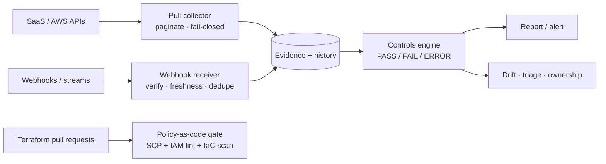
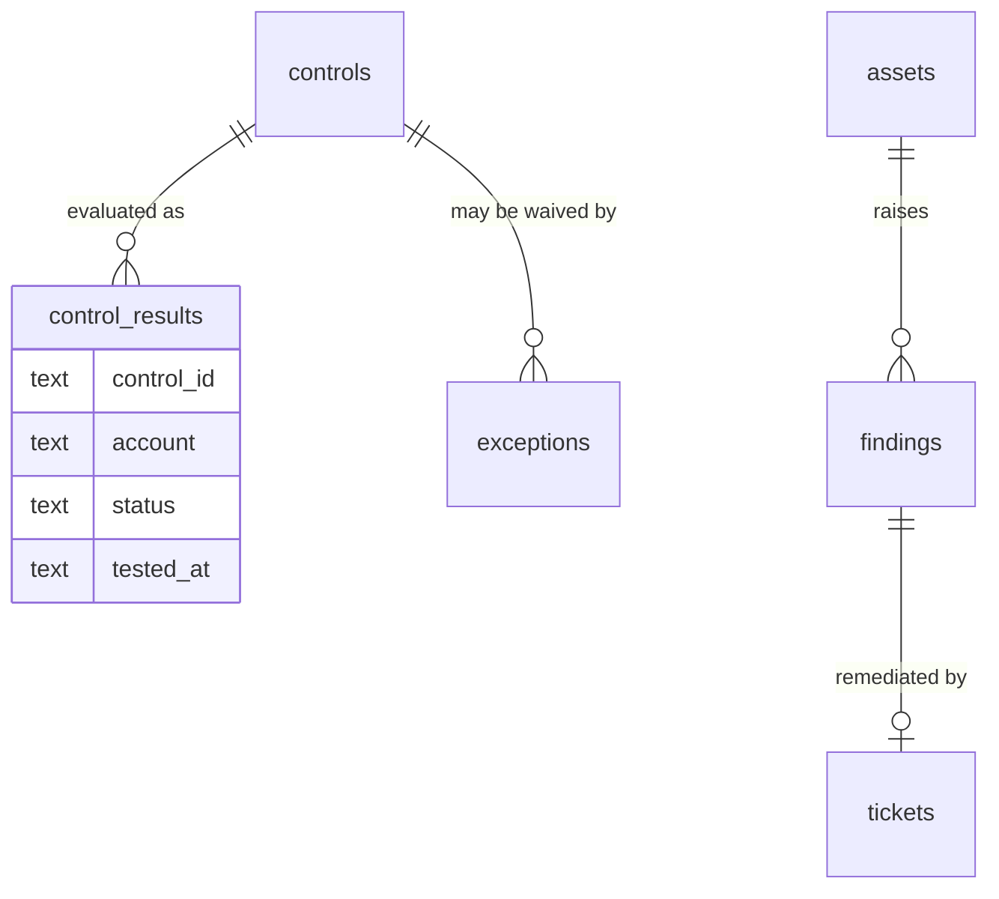
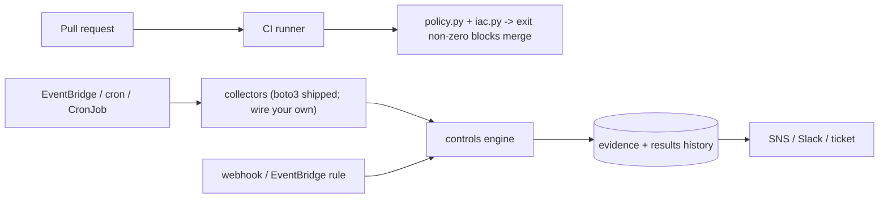

# GRC Engineering Playbook

**Runnable reference implementations for continuous compliance automation on AWS.**


## What this is

This repo is how I think compliance work should be engineered: controls as code, evidence collected
continuously over the full population of resources, and enforcement moved into CI where stopping a
bad change is cheap. It is a working proof of concept, not a production system - but every claim in
it runs, and the hard parts (what happens when an evidence source dies, how you attribute an
out-of-band change, how you stop a wildcard IAM policy before it merges) are implemented, not
hand-waved.

I built it with an agentic workflow - most of the drafting ran on an agent I drove, and it did not
take long. That is the point, and it is the same way I work day to day: the leverage is real, but
only if a human owns the design decisions and can explain every line that ships. I can. The full
account is in [docs/how-it-was-built.md](docs/how-it-was-built.md).

To be upfront about scope: I do not know your infrastructure, your account layout, or your existing
tooling. This is the approach I would bring, shown end to end on bundled examples and against a live
LocalStack run. The seams you would wire to your own systems are called out explicitly.

## Why I built it

The thing that gets me in day-to-day security and compliance work is how much human bandwidth gets
burned on work that should not need a human. Evidence pulls, access reviews, chasing down who
changed what, re-collecting the same screenshot for the third framework - that is keeping the
lights on, not moving anything forward. And it is not just tedious; it is where errors hide. The
more of your program runs on manual effort, the more of it can silently be wrong.

The tooling to fix this exists now in a way it did not a few years ago. Deterministic checks are
cheap to codify, and agentic workflows can carry the repetitive load - so spending skilled people's
time on the mechanical parts is a choice, and increasingly a bad one. I would rather point that
bandwidth at the questions that actually need judgment: where do controls silently fail, what is
the next thing to build, how do we get ahead of the audit instead of reacting to it. This repo is
that philosophy made concrete: automate the mechanical, fail closed when the automation cannot be
sure, and keep a human on the decisions that matter.

## Design principles

Every decision in this codebase traces back to something that actually happened - a control that
looked green and was not, a change that got blamed on the wrong deploy, an evidence pull that ate
an afternoon. Each one is a deliberate trade, and the trade is almost always the same two
currencies: **accuracy** (does the answer mean something) or **speed** (does it save a human from
mechanical work).

These are the design principles I build to, not seven one-off choices. Accuracy or speed - every
one of them buys at least one, and none of them spends the other carelessly.

| # | Decision | What it buys / what the naive version breaks |
|---|---|---|
| **D1** | Controls are declarative data | **Speed + accuracy.** A control change is a JSON diff compliance reviews, not a deploy. Naive: control logic in code means every change is a code change nobody outside engineering can read. |
| **D2** | Missing or stale evidence fails closed | **Accuracy.** A dead or stale evidence source reads ERROR, never green. Naive: no data = pass, so a broken pipeline looks compliant. That is how you fail an audit believing you passed. |
| **D3** | Raw before parsing | **Accuracy.** The raw payload is the evidence; the parse is your interpretation and your recovery path when your parser has a bug. |
| **D4** | Timestamp inside the signature | **Accuracy.** HMAC over `timestamp.body` gives every request a freshness window. Naive: body-only HMAC never expires, so a captured request replays forever. |
| **D5** | Attribute drift by field, not recency | **Accuracy.** Match the CloudTrail action to the field that changed. Naive: blame the latest event - usually the wrong change, and a wrong accusation is worse than none. |
| **D6** | Policy-as-code gates the PR | **Speed.** Stop the public bucket or wildcard policy in review, where it is cheap. Naive: detect it in production and pay for it later. |
| **D7** | AI proposes; a human attests | **Speed + accuracy.** Reads autonomous, writes behind approval, output treated as untrusted. Naive: no agents (wasted leverage) or agents with write access (uncontrolled blast radius). |

## Walk through it with me

The example I keep coming back to is the bucket that loses encryption. Someone turns it off - maybe
a mistake, maybe a shortcut, maybe worse. Without automation you do not find out when it happens.
You find out at month-end, when your analytics show a red in a category, and now you are days
behind and fully reactive - and if it was an attacker and your other layers missed it, you are in
real trouble.

Run the scenario and watch that gap close:

```console
$ python -m grc_playbook scenario
```

The bucket `bucket-prod-data` loses its encryption, the control fails, drift attributes the change
to the Terraform apply that caused it, you apply the fix, and the control goes green on
re-evaluation. About twenty lines of narration against real engine output, on a throwaway copy.
The whole point is shrinking that gap from weeks to hours: you wake up the next morning to "someone
changed the encryption on this bucket, here is who and what happened," instead of discovering it at
the end of the month.

## Terraform review

A review like this starts from a snippet someone hands you and asks "what would you change?" This
repo ships a real broken-to-fixed pair under [`examples/terraform/`](examples/terraform/): an
insecure stack (S3 with no encryption or public-access block, SSH open to `0.0.0.0/0`, an inline DB
secret, a public unencrypted RDS instance, and a full-admin IAM policy) and the same stack
remediated. [`docs/terraform-review.md`](docs/terraform-review.md) walks the review the way I would
do it live - what I flag, why it matters, and the fix - and the same checks run as a CI gate, so the
insecure version never merges. Prevention and detection, not one or the other.

## How I handle false positives and failure

Two different problems, and I treat them differently.

**False positives are a detection-quality problem, not a suppression problem.** When an alert fires
and it is noise, the first move is to understand *why* it fired - a real misconfiguration, or a
wrong detection? If it is genuinely just a noisy signal, tune it by fixing the detection (a better
filter, a tighter condition) so you keep the underlying signal, not by suppressing the alert and
losing it. A high false-positive rate is information about your detection quality, and "just
suppress it" is how real issues start getting ignored.

Who does that triage is an expected-value calculation, not a default. Agent tokens are far cheaper
than human tokens - but humans are still far more *effective*, and human attention is the scarcest
resource in the whole system. So the game is not "throw agents at everything." It is: spend agent
effort up to the point of expected value, and the moment auto-resolving something gets more
expensive in tokens or time than a person just looking at it, hand it to a human. You want to push
that handoff as far out as you can, but you do not pretend it is not a real tradeoff - you cannot
just throw money at the problem. The triage module here is the cheap first pass of that: dedupe
across scanners, re-score by exploitability, so by the time a human (or an expensive agent run)
sees the queue, it is already de-noised.

**Failure is different: automation should break extremely loud.** "We did not know if it was
running" is worthless - straight up. If your evidence pipeline dies and the dashboard stays green,
you do not have monitoring, you have a false sense of security. So the design rule in this repo is
fail closed: missing evidence, stale evidence, a broken collector - all ERROR, never PASS - and I
would put a watcher on every stage of the pipeline so a silent death is itself an alarm. You cannot
depend on a system you cannot see the health of.

---

## Architecture



Read it left to right: sources feed collectors, evidence lands in one store, the controls engine
evaluates it, and results drive reporting and response. The policy gate on the far right runs in CI,
where stopping a bad change is cheap.

This is the reference shape, not a deployed system. The modules in this repo implement the evaluate,
respond, and gate boxes, plus a reference pull collector for AWS (`collect_aws.py`, optional, needs
boto3). The ticket sink is the seam you wire to your own systems.

The data model is small, and append-only where it matters:



## Capabilities

Every module runs against the data in [`examples/`](examples/). The two that need a process (the
webhook receiver and the mock API) start a local server:

```
python -m grc_playbook <command>
```

| Module | Command | What it does |
|---|---|---|
| [`controls.py`](src/grc_playbook/controls.py) | `controls` | Declarative controls over full-population evidence; `PASS` / `FAIL` / `ERROR`, missing evidence fails closed |
| [`drift.py`](src/grc_playbook/drift.py) | `drift` | Live state against approved baseline; severity by blast radius; CloudTrail attribution matched to the field that drifted |
| [`triage.py`](src/grc_playbook/triage.py) | `triage` | Dedupe findings across scanners, re-score by exploitability and regulated data, route by owner, escalate by age past SLA |
| [`logs.py`](src/grc_playbook/logs.py) | `logs` | Audit log-protection posture; detect the `StopLogging` to activity tamper sequence |
| [`ownership.py`](src/grc_playbook/ownership.py) | `ownership` | Tag coverage, creator inference from CloudTrail, and a remediation queue that flags uncertain cases for review |
| [`policy.py`](src/grc_playbook/policy.py) | `policy` | SCP coverage and dangerous IAM allows, checked before merge; the IAM-deny check also ships as OPA/Rego in [`examples/rego/`](examples/rego/), executed in CI to prove the two agree |
| [`iac.py`](src/grc_playbook/iac.py) | `iac <dir>` | Terraform security review with concrete fixes; grep-based, not resource-aware; exits non-zero so CI blocks the merge |
| [`webhook.py`](src/grc_playbook/webhook.py) | `webhook` | Inbound events: HMAC with the timestamp inside the signature, replay window, dedupe on the signature, raw payload persisted |
| [`grc_api.py`](src/grc_playbook/grc_api.py) | (library) | Client for a GRC product API: bearer auth, cursor pagination, bounded retries, idempotency keys |
| [`mock_grc_api.py`](src/grc_playbook/mock_grc_api.py) | `mock-api` | A local stand-in for a GRC product API, so the client runs without a vendor |

## Frameworks

A control set is just data, so mapping a framework is another JSON file. The bundled
[`examples/frameworks/nist-csf-2.0.json`](examples/frameworks/nist-csf-2.0.json) is the full NIST
Cybersecurity Framework 2.0 core: 106 subcategories across six functions (Govern, Identify, Protect,
Detect, Respond, Recover) and 22 categories. Every subcategory is mapped:

- **17 are measured** by the engine against evidence from the AWS services it models (S3, IAM,
  GuardDuty, CloudTrail, RDS, Security Hub, and more). The AWS collector covers the services it can
  and the rest run against bundled fixtures; each measured control names the source it reads, and the
  direct config checks name the API call (for example `s3:GetBucketEncryption`).

One control maps to many frameworks: **`python -m grc_playbook crosswalk`** shows a single control
satisfying SOC 2, ISO 27001, and NIST refs at once (14 controls cover 33 framework refs across 3
frameworks, with more intended), and the NIST measured set reuses the canonical controls by id
(`uses`) so the two cannot drift. `results[].mappings` carries every framework a control satisfies.
- **89 are suggested**: governance, response, and process outcomes that are not config checks. Each
  names the source that would evidence it and what a human would measure or attest.

The integration specs consolidate the research onto the tool that is the right home for each domain,
so one pass covers many controls: **Okta** for identity, **Jamf** for devices, **GitHub** for SDLC
and supply chain, **Kubernetes** for workloads, and **Wiz** for cloud posture. Each spec names the
endpoint, the fields to read, and a draft response. AWS infrastructure config is modeled directly in
the framework file (`aws` / `source` / `measure` per subcategory) rather than a JSON spec, and the
remaining suggested subcategories name a third-party source (ServiceNow, PagerDuty, Snyk, and so on)
and the record a human would attest.

- Per-subcategory coverage: [`docs/nist-csf-2.0.html`](docs/nist-csf-2.0.html)
- Per-tool API specs and draft responses: [`docs/integrations.html`](docs/integrations.html)

```console
$ python -m grc_playbook frameworks
$ python -m grc_playbook controls --framework nist-csf-2.0
summary: 4 pass | 13 fail | 0 error | 89 manual | 106 total
```

Measured subcategories produce PASS/FAIL; suggested ones report `MANUAL`.

The same engine and control set also run against live AWS API calls via LocalStack; see
[`docs/localstack-demo.md`](docs/localstack-demo.md), where the seeded misconfigurations come back as
FAILs and the unimplemented services come back as ERRORs (fail-closed, not green).

This is also the shape continuous compliance is converging on. FedRAMP 20x's Key
Security Indicators (KSIs), introduced in 2025, work the same way: a machine-readable
package where each indicator resolves to a validation that is true or false, regenerated
on demand from live state instead of screenshotted for an annual audit. The measured
subcategories here are KSI-style validations; the suggested ones cover the process and
attestation work that still needs a human. The engine output (`results[].mappings`
included) is JSON from one run, so it can be regenerated whenever an assessor asks.

## Try it yourself

```console
$ python -m grc_playbook controls
[FAIL] GR-S3-001    critical  S3 buckets must have server-side encryption
         resource: bucket-prod-data (account 111111111111)
            - encryption.enabled = False (eq True)
[ERR ] GR-SES-001   low       SES suppression list reviewed monthly
         note: evidence source missing: evidence/ses_suppression_list.json (silent gap = control failure)
summary: 1 pass | 12 fail | 1 error | 0 manual | 14 total
```

```console
$ python -m grc_playbook drift
[CRITICAL] sg-app-01            CHANGED
           - ingress: ['10.0.0.0/8:443'] -> ['0.0.0.0/0:22'] (critical)
           attributed to: jdoe@acme.com via console at 2026-10-05T14:02:11Z (AuthorizeSecurityGroupIngress)
           detail: added 0.0.0.0/0:22 to sg-app-01 (temporary debug, never removed)
           action: OPEN TICKET
```

```console
$ python -m grc_playbook iac examples/terraform/broken
  [FAIL] No IAM policy with a bare wildcard action
        fix: scope actions and resources; no full-admin
8 finding(s)          # exit code 1, so CI blocks the merge
```

## Quickstart

```bash
git clone https://github.com/shrimp-burner/grc-engineering-playbook.git
cd grc-engineering-playbook

pip install -e ".[dev]"      # no runtime deps; the dev extra adds pytest
python -m grc_playbook demo   # runs the seven batch modules end to end
python -m grc_playbook scenario
python -m pytest -q           # the test suite
```

No install handy? `PYTHONPATH=src python -m grc_playbook demo` runs straight from the repo root.

## How it runs

The engine is stateless: give it a control set and a directory of evidence, and it returns
PASS / FAIL / ERROR / MANUAL plus a report. Collection is separate, so the engine drops wherever
compute already is. Three places it slots in:



- **Compute** is whatever runs your jobs. A CI runner for the pre-merge gate; a Lambda (or an ECS
  Fargate task for long sweeps) behind EventBridge Scheduler for the continuous run; a Kubernetes
  CronJob if you are in-cluster. The engine has no server and no database of its own.
- **Storage**: raw evidence to S3 (KMS, versioned; Object Lock for the audit copy); results history to
  a table (DynamoDB, or the SQL schema in [`sql/`](sql/)); analytics run over history, not one snapshot.
- **CI/CD placement**: policy-as-code and the IaC scan gate the pull request; the controls engine runs
  after deploy against the real account; drift detection runs on a schedule and on change.
- **Why stateless matters**: the same control set and engine run in the PR, on a schedule, and on an
  event. Only the evidence source changes.

## From control data to risk signal

Results history is the asset, not the single run. [`sql/queries.sql`](sql/queries.sql) is the KPI
layer as plain SQL (works in SQLite; the window functions run in Snowflake/Postgres/BigQuery): pass
rate per framework, mean time to resolve per team, findings with no ticket, assets with no owner,
and controls that flipped PASS-to-FAIL (drift, in one query). Point a dashboard tool (Mode, or a
Snowflake-backed notebook) at the history table and those are leadership's risk signals. In a
production deployment the history lands in the warehouse the team already uses; the queries here are
the shape, not a new stack to adopt.

## Reading vendor API docs

Every mapping in the NIST set was built the same way, and it is the same method for any new tool:

1. Find the resource in the vendor's API reference (the object you would query).
2. Find the field that answers the subcategory (a boolean, a policy list, a timestamp).
3. Record a draft response so the mapping is concrete rather than hand-wavy.

Examples drawn from real docs:

- **Okta** - the System Log API (`/api/v1/logs`) for auth events, plus `/api/v1/users`,
  `/users/{id}/factors`, `/api/v1/groups`, and policies. One research pass covers the identity
  controls (PR.AA-*, GV.RR-02, DE.CM-03).
- **Jamf Pro** - `/v1/computers-inventory` (FileVault status, `operatingSystem.version`, installed
  apps) and patch policies.
- **GitHub** - branch protection, code scanning (CodeQL), Dependabot, the org audit log, and artifact
  attestations.
- **Wiz** - the GraphQL `issuesV2`, `cloudResourcesV2`, `dataFindings`, and `detections` queries.
- **Kubernetes** - `kubectl get clusterrolebindings`, NetworkPolicies, Pod Security, plus the
  ecosystem: Kyverno/OPA, Falco, Trivy, cosign, Velero, kube-bench.
- **AWS** - the boto3 collector (several paginated calls per service); see
  [`src/grc_playbook/collect_aws.py`](src/grc_playbook/collect_aws.py).

Every tool draft lives in [`docs/integrations/`](docs/integrations/) as raw JSON and is rendered in
[`docs/integrations.html`](docs/integrations.html) (AWS config is modeled in the framework file, not
here). To add a tool: drop `docs/integrations/<tool>.json` in the same shape, add the name to
`INTEGRATION_TOOLS` in [`scripts/render_docs.py`](scripts/render_docs.py), and run
`python scripts/render_docs.py`. The pattern is the same for a SaaS product or Kubernetes.

## What this is, and what it is not

This is a readable reference, not a product. The seams that matter are implemented (fail-closed
evidence, replay-resistant signatures, field-level drift attribution, cross-scanner triage, the CI
policy gate). Deliberately left out, because they belong to your environment, not a public example:
real vendor collectors beyond AWS (the integration specs show the method), a results-history store
wired to a warehouse (the schema and queries are here), and agent write-tools behind an approval
queue (decision D7 defines the contract; the integration specs gate writes like Jamf MDM commands).

## Working with an agent

[`AGENTS.md`](AGENTS.md) tells an AI coding agent what this repo is, how it's structured, and the
decisions it's built around, so it can orient and review without guessing.

## Repository layout

```
src/grc_playbook/   the nine modules, scenario, and CLI (standard library only;
                    collect_aws.py is the optional boto3 collector seam)
examples/           sample controls, evidence, findings, baselines, policies, Terraform
examples/rego/      the IAM-deny check as OPA/Rego (mirrors policy.py)
sql/                compliance schema and analytics queries
tests/              pytest unit tests
scripts/            policy_check.py (the CI gate), render_docs.py (docs build),
                    demo_localstack.py (the live LocalStack demo)
docs/               how-it-was-built note, LocalStack demo, Terraform review,
                    rendered HTML for the NIST set and the integration specs
```

## License

MIT. See [LICENSE](LICENSE). This is a reference, not a product: read it, run it, reuse whatever is
useful.
